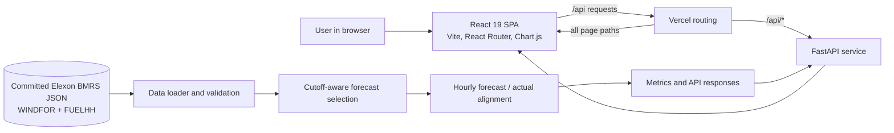

# WindLens

WindLens is a UK wind forecast review desk. It replays the forecast that was available at a selected decision cutoff, aligns it with settled wind generation, and reports forecast error and data coverage. The pilot uses January 2026 Elexon BMRS records.

**Live app:** [q7m4x9-green.vercel.app](https://q7m4x9-green.vercel.app) · **Workspace:** [Open the desk](https://q7m4x9-green.vercel.app/app)

WindLens reports volume accuracy in MW/GWh. It does not calculate electricity prices, imbalance cash costs, savings, or trading profit and loss.

## What the app does

- **Position overview (`/app`)** — cutoff and date controls, KPI cards, forecast/outturn chart, error distribution, daily performance, and a decision readout.
- **Forecast review (`/app/analysis`)** — compares day-ahead cutoffs and lets users inspect delivery intervals, including over-forecast, under-forecast, and tail-risk filters.
- **Data integrity (`/app/data-quality`)** — summarizes source validation, record counts, cadence, boundaries, and matched-hour coverage.
- **Method notes (`/app/methodology`)** — explains forecast selection, alignment modes, metric definitions, and limitations.

The default workspace view evaluates 1–7 January 2026 with the D−1 12:00 UTC cutoff and exact-hour alignment. Its current result is 1,757 MW MAE, +1,574 MW mean bias, and 85.7% coverage (144 of 168 hours). The coverage is below 100% because the supplied forecast file has no eligible D−1 forecast for 1 January; those hours are excluded rather than scored with information published after the cutoff.

## Architecture



### Request and data flow

1. The React single-page app reads the chosen cutoff, delivery window, and alignment mode, then requests `/api/health`, `/api/summary`, or `/api/timeseries`.
2. Vercel sends `/api/*` requests to the FastAPI backend service. Other paths go to the Vite-built frontend; the frontend service rewrites page routes to `index.html` so links such as `/app/analysis` work when opened directly.
3. FastAPI loads the committed JSON datasets through `backend/app/data_loader.py`. `backend/app/validation.py` reports record, schema, cadence, null, and boundary checks.
4. `backend/app/forecasting.py` selects the latest forecast published on or before the selected decision cutoff, then aligns it with actual generation using exact-hour or hourly-mean alignment.
5. `backend/app/metrics.py` calculates MAE, RMSE, signed bias, WAPE, nRMSE, correlation, energy totals, and daily summaries. Pydantic models in `backend/app/schemas.py` define API responses; React renders the results as cards, charts, and tables.

### Main API routes

| Route | Purpose |
| --- | --- |
| `GET /api/health` | Backend and dataset load status |
| `GET /api/quality` | Dataset validation and quality report |
| `GET /api/summary` | Metrics, daily results, alignment coverage, and quality report |
| `GET /api/timeseries` | Forecast/actual values and errors by delivery hour |

The summary and time-series routes accept cutoff, alignment, and optional January 2026 start/end dates. See the endpoint definitions in [`backend/app/main.py`](backend/app/main.py).

## Data and evaluation rules

- **WINDFOR:** 18,104 hourly forecast records across 248 publication vintages.
- **FUELHH:** 1,536 half-hourly wind actual records: 1,488 January records plus 48 records for 1 February. February records are excluded from January evaluation.
- **Exact hour:** matches each hourly forecast to the `:00` actual.
- **Hourly mean:** averages the `:00` and `:30` actuals for each clock hour.
- **Anti-lookahead:** a forecast is eligible only when its publication time is at or before the simulated cutoff. The most recent eligible vintage is selected for each delivery hour.
- **Error sign:** forecast minus actual. Positive bias means the forecast was above the settled outturn on average.

Both data files are included so the project can run without a separate data download. Each dataset is stored once in `backend/data/raw/`; duplicate copies with a `.json.json` suffix were removed because they had identical contents.

## Repository layout

```text
windlens/
├── .github/workflows/docker-build.yml  # CI image build (does not publish an image)
├── .env.example                         # Optional local environment settings
├── .gitignore
├── backend/
│   ├── app/                             # FastAPI routes, data, forecasting, metrics, schemas
│   ├── data/raw/                        # WINDFOR and FUELHH JSON datasets
│   ├── tests/                           # API, data, alignment, and metric tests
│   ├── Dockerfile                       # Backend-only container
│   └── requirements.txt
├── docs/demo-script.md                  # Two-part video walkthrough outline
├── frontend/
│   ├── public/                           # App icons
│   ├── src/components/                  # Landing page, controls, charts, tables, audit view
│   ├── src/App.jsx                      # React routes and workspace data loading
│   ├── src/api.js                       # API base URL helper
│   ├── src/index.css                    # Product styles and design tokens
│   ├── index.html
│   ├── package.json
│   ├── package-lock.json
│   └── vite.config.js                    # Local /api proxy to FastAPI
├── Dockerfile                           # Multi-stage full-app image
├── docker-compose.yml
├── vercel.json                           # Vercel services and request routing
└── README.md
```

## Run locally

Prerequisites: Python 3.11 or newer, Node.js/npm. Docker is optional.

**1. Start the backend** in one terminal:

```powershell
cd backend
python -m pip install -r requirements.txt
python -m uvicorn app.main:app --host 127.0.0.1 --port 8000 --reload
```

**2. Start the frontend** in another terminal:

```powershell
cd frontend
npm ci
npm run dev
```

Open [http://localhost:5173](http://localhost:5173). Vite proxies `/api` requests to the backend at `http://localhost:8000`.

To run the backend tests:

```powershell
python -m pytest backend/tests -v
```

To build and run the full app with Docker, when Docker is available:

```powershell
docker compose up --build
```

Then open [http://localhost:8000](http://localhost:8000). GitHub Actions also builds the root Docker image on pushes and pull requests to `main`; it does not publish the image to a registry.

## Deployment

The public app is deployed to Vercel from this repository. [`vercel.json`](vercel.json) defines two services: `frontend` (Vite) and `backend` (FastAPI). Top-level rewrites route `/api/*` to the backend and all other requests to the frontend; the frontend's own SPA fallback serves `index.html` for direct page links. No Docker installation is required to use the hosted app.

- [Live landing page](https://q7m4x9-green.vercel.app)
- [Live workspace](https://q7m4x9-green.vercel.app/app)
- [Backend health check](https://q7m4x9-green.vercel.app/api/health)

## Demo and disclosure

The challenge walkthrough outline is in [`docs/demo-script.md`](docs/demo-script.md). It covers a customer-facing product presentation and a short technical handover; keep the final video within the challenge's stated total time limit.

AI tools supported development, debugging, data analysis, and documentation. The project author is responsible for reviewing the code and explaining its cutoff, alignment, metrics, and limitations.
